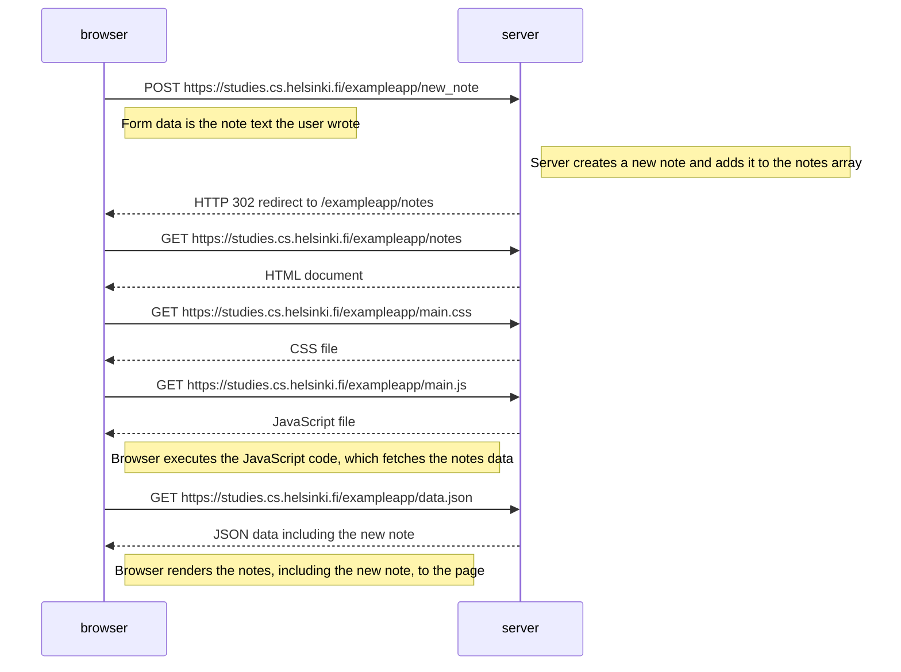
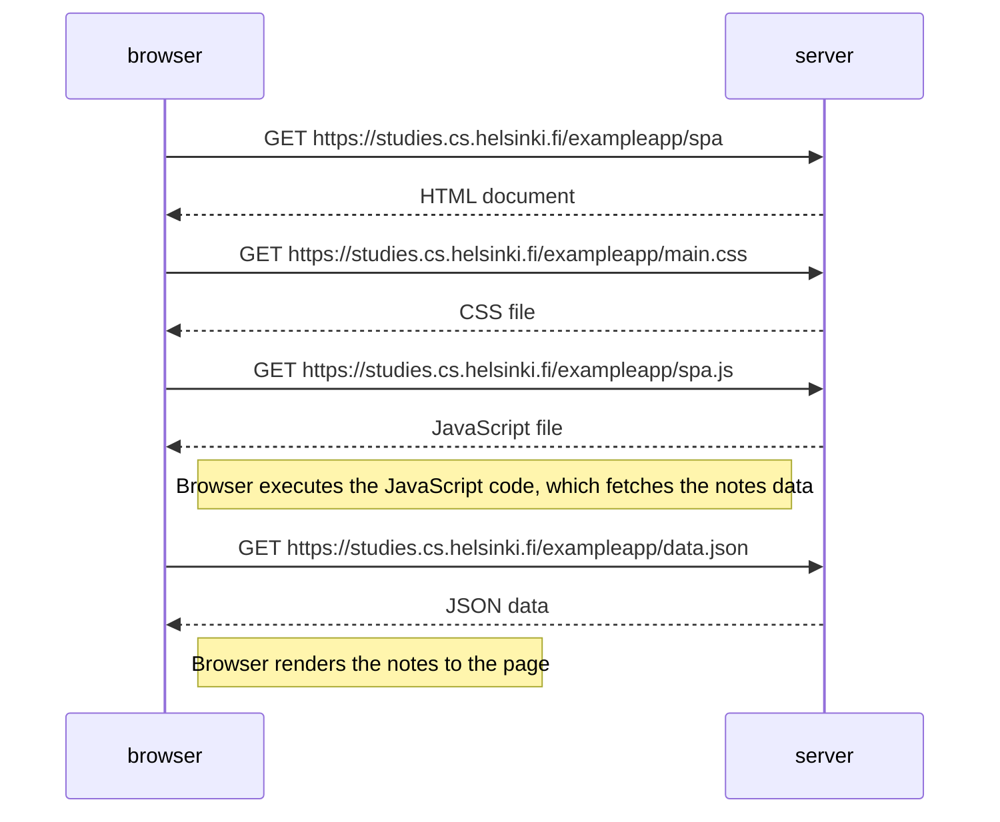
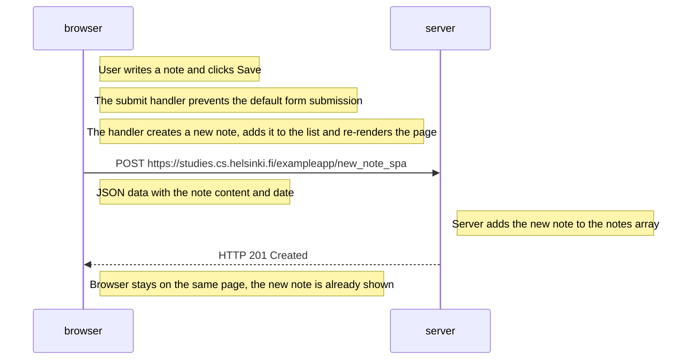

# Part 0 — Fundamentals of Web apps

Exercises 0.1, 0.2 and 0.3 were reading exercises (MDN tutorials on HTML, CSS and HTML forms) and are not submitted as files, as stated in the course material.

Exercises 0.4, 0.5 and 0.6 are the sequence diagrams below, made with Mermaid syntax in GitHub Markdown.

## 0.4: New note diagram

The user creates a new note on https://studies.cs.helsinki.fi/exampleapp/notes by writing something into the text field and clicking Save (traditional web application).

## 0.5: Single page app diagram

The user goes to the single-page app version of the notes app at https://studies.cs.helsinki.fi/exampleapp/spa.

## 0.6: New note in Single page app diagram

The user creates a new note using the single-page version of the app at https://studies.cs.helsinki.fi/exampleapp/spa.

